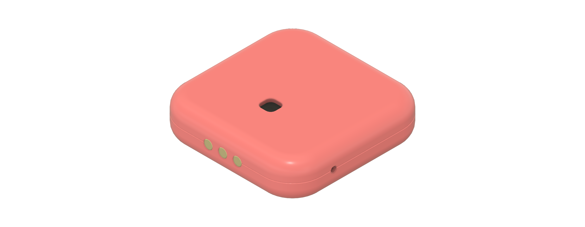
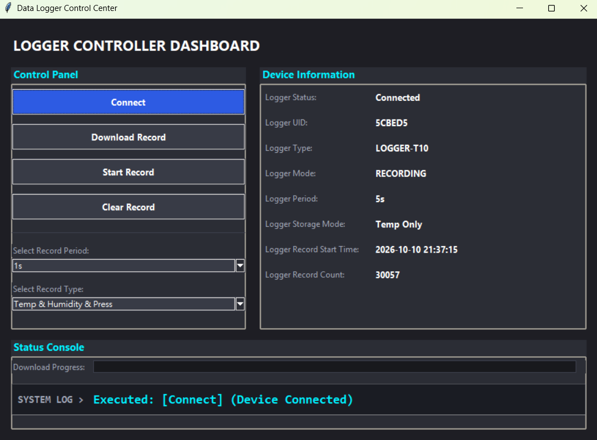

# Logger - T10 (Temperature, Humidity, Air Pressure)

###Description
The Logger Series is a lightweight and slim sensor designed for uninterrupted, offline data recording over extended periods. Each unit can continuously log data for up to three years. It's ideal for wearable devices or scientific record.

The Logger-T10 is a sensor in Logger Series designed to record temperature, humidity, and air pressure data with precision.

### Technical Specification

> #### General Details

> | Parameter |  |
> | :--- | :--- |
> | **Size** | 24.8mm x 24.8mm x 6.8mm |
> | **Battery Type** | CR1625 Non-Rechargeable Lithium Battery |
> | **Battery Capacity** | 90mAh |
> | **Battery Life (recording)** | 1~3 years |
> | **Data Type** | Temperature, Humidity, Air Pressure |
> | **Recording Period** | 1s to 12hour |

> #### Temperature Sensor

> | Parameter | |
> | :--- | :--- |
> | **Temperature Range** | -10&deg;C to 50&deg;C |
> | **Temperature Resolution** | 16 bits |
> | **Temperature Accuracy** | &#177 0.1&deg;C |

> #### Humidity Sensor

> | Parameter | |
> | :--- | :--- |
> | **Humidity Range** | 0% to 100% |
> | **Humidity Resolution** | 16 bits |
> | **Humidity Accuracy** | &#177 0.15% |

> #### Air Pressure Sensor

> | Parameter | |
> | :--- | :--- |
> | **Air Pressure Range** | 26kPa to 126kPa |
> | **Air Pressure Resolution** | 24 bits |
> | **Air Pressure Accuracy** | &#177 0.02kPa |

> #### Battery and Storage Life

> | Period | Storage Capacity Life | Battery Life |
> | :--- | :--- | :--- |
> | 1min | 1.14 years | 2.43 years |
> | 5min | >3.35 years | 3.35 years |
> | 15min | >3.5 years | 3.5 years |
> | 30min | >3.5 years | 3.5 years |
> | 1hour | >3.5 years | 3.5 years |

> Using 90mAh 1625 lithium battery.

> Battery life is calculated under ideal situation, no operation during data recording. Operation like download data, restart the logger, blinking LED during recording will consume extra power and make the battery shorter than calculated.

### Software

> This software is use to control the logger with following function:
> * Start Recording
> * Download Data
> * Clear Data
> * Check recording status

> [>>Windows Download<<](files/LOGGER Reader.exe)

### Operation

#### Start Record
> 1. Plug in the battery, negative pole at the PCB side.
> 2. Connect the logger, reader to PC. 
> 3. Open the Software, press **Connect**, wait complete.
> 4. Select recording period(1s to 12hours) and recording type (temperature, humidity, air pressure).
> 5. Press **Start Recording**, wait complete.
> 6. Remove the logger from the reader.

> Tips: Check recording status any time, by plug the logger to reader, and **Connect** it to the software.

#### Clear Record
> 1. Connect the logger, reader to PC.
> 2. Open the Software, press **Connect**, wait connection complete.
> 3. Press **Clear Record**, wait complete.

#### Download Data
> 1. Connect the logger, reader to PC.
> 2. Open the Software, press **Connect**, wait connection complete.
> 3. Press **Download Record**, wait complete.
> 4. Generated report will appear at the software same folder.

#### Replace Battery
> 1. Open the battery case.
> 2. Push the battery out using a pin.
> 3. Plug the new battery in (negative pole at the PCB side) and close the battery cover.

###Tips
> Software connection failed check list:
> * Reader is connected to PC.
> * Logger is connected to Reader.
> * Logger is not out of battery, if yes, replace a new battery.
> * Connection pins on reader and logger is clean.

> Don't connect more than one reader to a PC.

> Don't put the reader into water.

